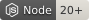
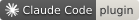

<p align="center">
  <a href="https://github.com/bubb4rd/tells">
    <picture>
      <source media="(prefers-color-scheme: dark)" srcset="docs/assets/icon-light.png">
      
    </picture>
  </a>
</p>

<h1 align="center">tells</h1>

<p align="center">
  <a href="https://github.com/bubb4rd/tells/actions/workflows/ci.yml"></a>
  
  
  <a href="#claude-code"></a>
  <a href="#license"></a>
</p>

<p align="center">Find the marks that give a screen away as default, AI-generated output, and fix the ones that have one right answer.</p>

<p align="center">
  <a href="#install">Install</a> ·
  <a href="#use">Use</a> ·
  <a href="#fix">Fix</a> ·
  <a href="#same">Same</a> ·
  <a href="#make">Make</a> ·
  <a href="#rules">Rules</a> ·
  <a href="#claude-code">Claude Code</a> ·
  <a href="#faq">FAQ</a>
</p>

<p align="center"></p>

A tell is the mark that gives a screen away as default output: the uppercase eyebrow over every heading, the purple gradient, the pill buttons, the three cards with icons in tinted squares, "Get started →". tells names them, catches the ones a machine can catch, and rewrites the ones with a single correct fix.

- **A rule set** ([`rules/anti-slop.md`](rules/anti-slop.md)) that names each tell and says what to do instead.
- **Two linters.** `tells check` reads HTML, CSS, JSX, TSX and MDX source. `tells render` loads pages in headless Chrome and checks contrast, overflow, tap targets, headings and images.
- **A fixer.** `tells fix` rewrites the hits that don't depend on the subject and reports the rest.
- **A loop with no picks.** `tells make` builds several variants of a brief in parallel with an agent, fixes them, and chooses one with `tells pick`, by checks and not by a taste score.
- **A sameness check.** `tells same` catches a design that lands on one of the five cliché looks, on your own house style, or on a copy of a sibling.
- **A playbook** ([`playbook/`](playbook)) for building a design system from a subject, reviewing it, and measuring taste.

It's built for product UI, the dashboards, tools and apps people use every day, and it runs on plain Node with no dependencies.

> [!NOTE]
> tells is early (0.1). The rules come from 2,286 blind picks by one designer. They're strong leads about one person's taste and solid evidence about the method. [`taste.md`](playbook/taste.md) says what that does and doesn't prove.

## Install

Requires Node 20 or later. `tells render` also needs Chrome or Chromium.

```sh
git clone https://github.com/bubb4rd/tells.git
cd tells && npm link        # puts `tells` on your PATH
```

Without `npm link`, call `node path/to/tells/bin/tells.mjs` in place of `tells`. Set `CHROME_PATH` if Chrome isn't in a standard place.

## Use

```sh
tells fix ./src                                     # rewrite what has one answer, report the rest
tells check ./src                                   # report only
tells render ./dist/index.html http://localhost:3000
tells same design-systems/                          # each design against the clichés and the others
tells make "a shift handover screen for night nurses" # brief in, one checked screen out
```

```
tells check  [paths...]        Static audit of HTML, CSS, JSX, TSX and MDX source
tells fix    [paths...]        Rewrite the hits that have one right answer, then report the rest
tells render [files|dirs|urls] Rendered audit in headless Chrome at 1440, 960 and 390px
tells same   [designs|urls...] Catch a design that lands on a cliché cluster, your house style or a sibling
tells pick   <variants...>     Choose between variants with checks: errors, exceptions, sameness, warnings
tells make   "<brief>"         Build variants in parallel with an agent, fix them, pick one, write a report
tells rules  [check|render|same] List every rule with its severity and fix

--json          Machine-readable output
--strict        Fail on warnings as well as errors
--rule <id>     Run one rule
--dry-run       fix: show what would change, write nothing
--radius <css>  fix: radius that replaces pills (default 6px)
--house <path>  same, pick, make: compare with this design instead of the majority
--against <p>   same, pick, make: past designs to compare with (repeatable)
--rendered      same: fingerprint rendered styles, colour role and layout in headless Chrome
--variants <n>  make: how many to build (default 4)
--agent <cmd>   make: agent command that reads the prompt on stdin (default claude -p)
--no-render     same, pick, make: skip the headless Chrome checks
--widths a,b,c  Viewport widths for render
```

Every command exits 1 when errors are left, so they work in CI as they are. Files with `mobile` in their path render at 390px only, unless you pass `--widths`.

Here is `tells fix` on the left half of the picture above ([`docs/shots/hero.html`](docs/shots/hero.html)), with long snippets shortened:

```
Fixed  2 changes
  hero.html:26  pill-radius   .pill { … border-radius: 6px; background: #7c3aed; … }
  hero.html:57  arrow-suffix  <span class="pill" …>Get started</span>

hero.html  10 error, 3 warn
  hero.html:12  [warn]  default-font    (Inter, 2 lines) …family=Inter:wght@400;700…
  hero.html:20  [error] glow-blur       (blur 60px) …radial-gradient(circle, #8b5cf6, transparent 70%); filter: blur(60px); }
  hero.html:21  [warn]  tracked-caps    (.eyebrow) …letter-spacing: 0.18em; text-transform: uppercase; …
  hero.html:24  [error] gradient-text   …-webkit-background-clip: text; background-clip: text; color: transparent; }
  hero.html:55  [error] italic-accent   Bike repair, reimagined ✨
  hero.html:57  [error] generic-cta     Get started
  hero.html:58  [error] dot-triplet     Fast · Secure · Simple
  …
```

The pill and the arrow had one right answer, so they're gone. Everything left needs a decision about the subject, and the report says what each rule wants instead.

### Exceptions

Some tells are right for a subject. Allow one hit with a comment on the same line or the line above, naming the rule and the reason:

```html
<div class="menu"> <!-- tells-ok: glass the menu sits over live map tiles -->
```

```css
.avatar { border-radius: 999px; } /* tells-ok: pill-radius avatars are circles */
```

A `tells-ok` with no reason, or with a rule that doesn't exist, is itself an error. `slop-ok:` works as an alias. For rendered checks in frameworks that strip HTML comments, `data-tells-ok="<rule-id> <reason>"` on the element or an ancestor works the same way.

## Fix

`tells fix` handles six rules where the right answer doesn't depend on the subject. It touches only open hits, never a line with a `tells-ok`, and a second run changes nothing.

| Rule | What it does |
|---|---|
| `transition-all` | Names the properties: the usual hover and focus set, plus whatever this element changes. In JSX that's its variant and conditional classes and its `style={{}}` keys; in CSS, what its `:hover`, `[aria-*]` and `.is-*` rules set. |
| `pill-radius` | Swaps each pill-sized value for `--radius` (default `6px`), so `9999px 9999px 0 0` keeps its square corners. A full radius on a square box is a circle and isn't flagged. |
| `bounce-easing` | Overshooting curves become `cubic-bezier(0.2, 0, 0, 1)`; spring `bounce` becomes 0. |
| `arrow-suffix` | Drops the arrow after a label. A lone arrow, as in `<kbd>→</kbd>`, is content and stays. |
| `reduced-motion-guard` | Adds one `prefers-reduced-motion` block to CSS and HTML. In JSX the motion library decides, so it's left for you. |
| `placeholder-copy` | Replaces John and Jane Doe and `@username` with realistic names, varied by file. Lorem ipsum and Acme need real copy and stay in the report. |

Copy, colour, type and layout need a decision about the subject. Those stay in the report.

## Same

A screen can pass every rule and still be the look you shipped last time. Left alone, a generator drifts back to whatever won before, and banning one look only moves it to the next default. `tells same` reads a design's `:root` tokens when present—or fingerprints the rendered page in headless Chrome when passed `--rendered`, a live URL, or a Tailwind/inline-style HTML page without `:root` tokens—and checks three things:

- **The cliché clusters.** Warm paper with a book serif, near-black with one acid accent, neo-Swiss, a glowing dark void, and soft commerce. These are clusters 1 to 5 in [`rules/anti-slop.md`](rules/anti-slop.md#3-colour-the-cliché-clusters).
- **Your house style.** On six static axes (page, ink, hairline, accent, typeface and radius)—plus two rendered axes (**colour role**: `monochrome`, `accent-dots`, `tinted-surfaces` or `structural-field`; and **layout**: `canvas-overlay`, `sidebar-main`, `split-pane`, `centered-hero`, `card-grid`, `top-nav-workspace` or `single-column`)—it finds the bucket most of a design's siblings share, and flags a design that matches the house across them (5 of 6 static, 6 of 8 rendered). Siblings are the other designs in the same folder, plus any you pass with `--against`. `--house <design>` compares with one design instead, such as the one that won last time.
- **Token copies.** Six or more colour tokens with a sibling's name and value.

```
✗ runout  design-systems/runout/tokens.css
    ● page      light neutral  = house (halyard)
    ● ink       near-black  = house (halyard)
    ● hairline  light grey  = house (halyard)
    ● accent    one  = house (halyard)
    ● typeface  neutral grotesk  = house (halyard)
    ● radius    card  = house (halyard)
    [error] house-style            6 of 6 axes: page, ink, hairline, accent, typeface, radius
```

If the subject earns the look, say so in its `tokens.css`, `DESIGN.md` or `directions.md`: `tells-ok: house-style <why this subject>`.

## Make

`tells make` takes a brief and returns one checked screen, with nothing to answer in between.

```sh
tells make "a shift handover screen for night nurses on a hospital ward" --against design-systems/
```

1. **Prompts.** One per variant (four by default), each with a different angle on the subject: its data, its documents, its place, its people, its rhythm or its region. Every angle leads with the product; none is a metaphor.
2. **Build.** An agent per variant, in parallel, each in its own folder. The default is Claude Code (`claude -p`, limited to reading, writing and running `node`). `--agent` takes any command that reads a prompt on stdin.
3. **Fix and pick.** `tells fix` on every variant, then `tells pick`: fewest rules broken, then fewest written exceptions, then off the cliché clusters and your house style. Warnings are shown but don't decide.
4. **Report.** `REPORT.md` has the ranking, why each loser lost, and the winner. Each variant keeps its prompt, the agent's log and its `NOTES.md`, which says where each colour comes from.

`tells pick` also works on its own, on variants from anywhere. On seven past rounds it agreed with the picker on 65% of the pairs it decided, and a top-half cut kept the picker's winner in 5.2 of 7 rounds, against 3.8 at random. It's good at cutting default-looking work. It can't yet choose between clean refinements of one design, and calls those ties. It doesn't use a taste model: one was tested on 15 generated rounds held out of training and did no better than chance ([`taste.md`](playbook/taste.md#checks-choose-some-rounds-not-all)).

## Rules

<details open>
<summary><b><code>tells check</code></b>: 31 rules on source</summary>

<!-- rules:check -->
| Rule | Severity | Category | `tells fix` | Fix |
|---|---|---|---|---|
| `eyebrow-copy` | error | copy |  | Drop the eyebrow. If the info matters, put it in the heading or a real metadata line the reader uses. |
| `decorative-data` | warn | copy |  | Keep data only if the screen's user reads and acts on it; invented precision is texture. |
| `status-theatre` | error | copy |  | Remove LIVE/BETA/NEW badges and status lines on things that have no status. |
| `fake-shortcut` | error | copy |  | Remove ⌘K / ↵ hints unless the shortcut actually exists. |
| `dot-triplet` | error | copy |  | Tagline rhythm ("Fast · Secure · Simple"). Write a sentence that says what it is. |
| `dot-separator` | warn | copy |  | Dot + label reads as an eyebrow. Make it a real metadata line or cut it. |
| `em-dash` | warn | copy |  | At most one em-dash per screen. Rewrite with a full stop or comma. |
| `arrow-suffix` | error | copy | yes | Drop the arrow suffix. Buttons name the actual action. |
| `generic-cta` | error | copy |  | Not "Get started" / "Learn more" / "Explore". Buttons name the actual action. |
| `meta-copy` | warn | copy |  | The page narrates itself. Demonstrate instead; explanation belongs in DESIGN.md. |
| `spec-adjective` | warn | copy |  | Cut the adjective. A spec sentence is a rule or a reason. |
| `placeholder-copy` | error | copy | yes | Replace placeholder names/copy (John/Jane Doe, @username, lorem ipsum, TODO) with realistic product data. |
| `tracked-caps` | warn | type |  | Uppercase + letter-spacing on small labels is default-off. Use sentence case and the system's own hierarchy. |
| `uppercase` | warn | type |  | Uppercase is default-off. Justify it or use sentence case. |
| `gradient-text` | error | type |  | Gradient text: never. Use a solid colour. |
| `italic-accent` | error | type |  | Drop the italic accent word. The headline says what the thing is or does. |
| `default-font` | warn | type |  | Default face. Justify it from the subject and name 2 rejected alternatives, or choose another. |
| `purple-default` | error | color |  | Purple/indigo is a default, not a choice. Derive the colour from the subject; every colour needs an origin. |
| `gradient-count` | warn | color |  | More than 6 gradients. Each one needs a reason; remove the decorative ones. |
| `pill-radius` | error | components | yes | No pills or capsules. Use the system's own radius. |
| `glass` | error | components |  | No backdrop-filter except over real content (menus, overlays). |
| `emoji-sparkle` | error | components |  | No emoji or sparkle icons. One consistent icon set, or none. |
| `side-tab` | error | components |  | No coloured left-border callouts. Use spacing, typography or the system's own surface hierarchy. |
| `numbered-section` | warn | layout |  | Numbered sections ("01 / PALETTE") are bento-by-default. Let content order carry the sequence. |
| `glow-blur` | error | decoration |  | Remove blurred blobs, orbs and radial glows. |
| `ambient-motion` | error | motion |  | No ambient looping motion. One purposeful transition tied to a user action, gated by prefers-reduced-motion. |
| `bounce-easing` | error | motion | yes | No bounce/overshoot easing (cubic-bezier y outside [0,1] or non-zero spring bounce). Use ease-out or cubic-bezier(0.2, 0, 0, 1). |
| `transition-all` | warn | motion | yes | Name the exact animated properties; never use transition: all or will-change: all. |
| `reduced-motion-guard` | warn | motion | yes | Gate keyframes and movement/scale/filter animations behind prefers-reduced-motion, motion-safe:, or MotionConfig. |
| `ok-reason` | error | meta |  | Every exception is written down: tells-ok: <rule-id> <reason>. |
| `ok-unknown` | error | meta |  | tells-ok names a rule id that doesn't exist. Check `tells rules`. |
<!-- /rules:check -->

</details>

<details>
<summary><b><code>tells render</code></b>: 23 rules on the rendered page</summary>

<!-- rules:render -->
| Rule | Severity | Category | Fix |
|---|---|---|---|
| `horizontal-overflow` | error | layout | Eliminate horizontal overflow (scrollWidth > viewport width) at every tested width. |
| `clipped-text` | warn | layout | Prevent text clipping or descender cut-off inside overflow:hidden containers (check wrapping, width, and line-height). |
| `cramped-padding` | warn | layout | Give bordered/surface containers at least 8px padding on non-zero sides. |
| `tall-top-nav` | warn | layout | Keep desktop top navigation on a single line and <= 80px tall. |
| `icon-feature-grid` | error | layout | Replace the 3–4 card icon-on-top feature grid with real product proof, a table, or copy that fits the subject. |
| `stat-strip` | warn | layout | Replace the row of identical big-number + tiny-label stat blocks with one focal number and the context or chart that explains it. |
| `template-hero-stack` | error | layout | Break up the template hero stack (badge + centred headline + subline + two buttons). Lead with the product or one direct action, and drop the badge. |
| `word-only-screen` | warn | layout | Add a visual layer that carries real information (a chart, data drawing, icon set on actions, or real imagery); word-only screens lack hierarchy. |
| `low-contrast` | error | color | Meet WCAG AA contrast: >= 4.5:1 for normal text, >= 3:1 for large text (>= 24px or >= 18.66px bold). |
| `accent-rainbow` | warn | color | Avoid an accent rainbow across badges and tags. Use one accent meaning per colour, or neutral surfaces with typography. |
| `tiny-text` | warn | type | Keep readable text >= 12px at mobile widths (and never < 10px anywhere). |
| `long-measure` | warn | type | Constrain multi-line prose blocks to <= 80ch for readability. |
| `flat-type-hierarchy` | warn | type | Establish clear type hierarchy: largest heading should be >= 1.2x body font size. |
| `missing-tabular-nums` | warn | type | Set font-variant-numeric: tabular-nums on numeric table cells and changing figures so digits align vertically. |
| `mono-costume` | warn | type | Reserve monospace for code, tabular figures, and copyable values (IDs, hex, paths), not prose or uppercase labels. |
| `small-tap-target` | warn | mobile | Make mobile interactive controls at least 44x44px (or expand their hit area). |
| `concentric-radius` | warn | surfaces | Match concentric radii on tightly inset surfaces (outerRadius = innerRadius + padding + borderWidth). |
| `split-surface` | error | surfaces | Keep primary navigation and canvas on cohesive surfaces; avoid pairing a dark sidebar with a light page. |
| `nested-cards` | error | surfaces | Avoid cards inside cards. Use spacing, typography or a single surface level instead of nested boxes. |
| `broken-image` | error | media | Fix broken image asset (naturalWidth === 0). |
| `duplicate-avatar` | error | media | Never reuse the same portrait/avatar image for two different people or duplicate the signed-in user avatar. |
| `skipped-heading` | warn | a11y | Do not skip heading levels (e.g. h1 -> h3); step down sequentially. |
| `missing-focus-ring` | warn | a11y | Never set outline: none/0 on :focus without a visible replacement (box-shadow, border-color, or :focus-visible ring). |
<!-- /rules:render -->

</details>

<details>
<summary><b><code>tells same</code></b>: 7 rules on a design's tokens</summary>

<!-- rules:same -->
| Rule | Severity | Fix |
|---|---|---|
| `cluster-warm-paper` | error | Cream paper, a book serif and a terracotta accent is cluster 1. Derive surface, type and accent from the subject, or name the printed source that earns them. |
| `cluster-acid-dark` | error | Near-black, hairlines and one acid accent is cluster 2. Ask what this subject's own surfaces and signals look like. |
| `cluster-neo-swiss` | error | Zero radius, hairline rules, condensed grotesk and red with blue is cluster 3. Keep the grid only if the subject's own documents use it. |
| `cluster-glow-void` | error | A dark void with glass, glow and violet or coral washes is cluster 4. Remove the effects and start from the subject's real materials. |
| `cluster-soft-commerce` | error | Putty, forest green or brass, pills and italic serif notes is cluster 5. Derive the palette from the products themselves. |
| `house-style` | error | This matches your house style: the look most of your other designs share, or the design named with --house. Derive it from this subject, or write why this subject earns it. |
| `token-copy` | error | Six or more colour tokens copied from a sibling. Every colour needs an origin in this subject. |
<!-- /rules:same -->

</details>

The full rule set, including the tells a linter can't check, is in [`rules/anti-slop.md`](rules/anti-slop.md).

### Why checkable rules

The rules came out of blind pairwise picks between generated designs and professional work. Two things held up:

1. Rules you can check (contrast, tap targets, pills, eyebrows) moved results. Rules about feel ("looks templated") didn't, and an LLM judge using them marked down plain, finished UI.
2. Left alone, a generator drifts back to whatever won last time. Banning a look isn't enough; every replacement needs a reason from the subject.

So the linters enforce the checkable half, and each exception has to be written down. [`taste.md`](playbook/taste.md) has the method and the evidence.

## Claude Code

The repo is a Claude Code plugin. Add it, and the `tells` skill loads the rules before UI work, runs `tells fix` and `tells render` after, and settles what's left from the subject instead of stopping to ask.

```
/plugin marketplace add bubb4rd/tells
/plugin install tells@tells
```

## FAQ

<details>
<summary><b>Will it flag my own design system?</b></summary>

It flags defaults, not choices. If a tell is right for your subject, a status pill on a live feed or glass over map tiles, allow it with `tells-ok` and the reason. The reason is the point: it's the difference between a choice and a habit.

</details>

<details>
<summary><b>Does <code>tells fix</code> change how my UI looks?</b></summary>

Only where a rule has one right answer. Pills get your radius and overshooting easing settles. Transitions keep animating what they animated before, now by name. Everything else is reported, not rewritten. Run it with `--dry-run` first to see the changes.

</details>

<details>
<summary><b>Does it understand Tailwind?</b></summary>

Yes. Utilities like `rounded-full`, `tracking-widest uppercase`, `bg-indigo-500`, `backdrop-blur`, `animate-pulse` and `transition-all` are checked alongside plain CSS, and `tells fix` writes Tailwind back: `transition-[color,max-width]`, `rounded-md`.

</details>

<details>
<summary><b>Why not ask a model to judge the design?</b></summary>

In testing, LLM judges marked down plain, finished UI as "generic" and fell for polish the rules ban. The linters check what can be checked. Taste is measured separately, with blind picks: see [`taste.md`](playbook/taste.md).

</details>

## Contributing

New tells, false positives and better fixes are all welcome. Start with [CONTRIBUTING.md](CONTRIBUTING.md) and the issue forms. To report a security problem, see [SECURITY.md](SECURITY.md).

```sh
npm test                  # every rule fires on its fixture; the clean page stays clean
npm run docs:rules        # regenerate the rule tables in this README
npm run shots             # re-render docs/assets from docs/shots (needs Chrome)
```

## License

Code is [MIT](LICENSE). The rules and playbook (`rules/`, `playbook/`) are [CC BY 4.0](https://creativecommons.org/licenses/by/4.0/).
