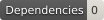
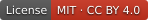

<p align="center">
  <a href="https://github.com/bubb4rd/tells">
    <picture>
      <source media="(prefers-color-scheme: dark)" srcset="docs/assets/icon-light.png">
      
    </picture>
  </a>
</p>

<h1 align="center">tells</h1>

<p align="center">
  <a href="https://github.com/bubb4rd/tells/actions/workflows/ci.yml"></a>
  
  
  <a href="#claude-code"></a>
  <a href="#license"></a>
</p>

<p align="center">Find the marks that give a screen away as default, AI-generated output, and fix the ones that have one right answer.</p>

<p align="center">
  <a href="#install">Install</a> ·
  <a href="#use">Use</a> ·
  <a href="#fix">Fix</a> ·
  <a href="#same">Same</a> ·
  <a href="#make">Make</a> ·
  <a href="#rules">Rules</a> ·
  <a href="#claude-code">Claude Code</a> ·
  <a href="#faq">FAQ</a>
</p>

<p align="center"></p>

A tell is the mark that gives a screen away as default output: the uppercase eyebrow over every heading, the purple gradient, the pill buttons, the three cards with icons in tinted squares, "Get started →". tells names them, catches the ones a machine can catch, and rewrites the ones with a single correct fix.

- **A rule set** ([`rules/anti-slop.md`](rules/anti-slop.md)) that names each tell and says what to do instead.
- **Two linters.** `tells check` reads HTML, CSS, JSX, TSX and MDX source, and scripts that build HTML in strings. `tells render` loads pages in headless Chrome and checks contrast, overflow, tap targets, headings and images, and the layouts that give a screen away: eyebrow labels, stat strips, cards inside cards.
- **A fixer.** `tells fix` rewrites the hits that don't depend on the subject and reports the rest.
- **A loop with no picks.** `tells make` builds several variants of a brief in parallel with an agent, fixes them, and chooses one with `tells pick`, by checks and not by a taste score. Give it a reference screen and each agent studies that screen's finish before it builds.
- **Products, not just screens.** `tells make --product` builds a product's system first, stops once for you to approve it, then builds every screen on it. `tells consistent` checks that the screens still read as one system.
- **A reference library.** `tells refs` keeps the shipped screens whose finish you want to reach, each with why it's good. Choosing them is how your taste gets in.
- **A sameness check.** `tells same` catches a design that lands on one of the five cliché looks, on your own house style, or on a copy of a sibling.
- **Numbers for taste.** `tells measure` profiles a rendered screen (what leads it and how big, how much the first screen holds, how many sizes and colours carry it) so you can compare it with shipped work.
- **A playbook** ([`playbook/`](playbook)) for building a design system from a subject, reviewing it, and measuring taste.

It's built for product UI, the dashboards, tools and apps people use every day, and it runs on plain Node with no dependencies.

> [!NOTE]
> tells is early (0.1). The rules come from 2,286 blind picks by one designer. They're strong leads about one person's taste and solid evidence about the method. [`taste.md`](playbook/taste.md) says what that does and doesn't prove.

## Install

Requires Node 20 or later. The rendered commands (`render`, `measure`, `consistent`, and `same --rendered`) also need Chrome, Chromium or Edge.

```sh
git clone https://github.com/bubb4rd/tells.git
cd tells && npm link        # puts `tells` on your PATH
```

Without `npm link`, call `node path/to/tells/bin/tells.mjs` in place of `tells`. tells looks for the browser where macOS, Linux and Windows install it, then on your `PATH`; set `CHROME_PATH` to use another binary.

## Use

```sh
tells fix ./src                                     # rewrite what has one answer, report the rest
tells check ./src                                   # report only
tells render ./dist/index.html http://localhost:3000
tells same design-systems/                          # each design against the clichés and the others
tells make "a shift handover screen for night nurses" --kind list # brief in, one checked screen out
tells measure http://localhost:3000                 # lead, density and type steps, as numbers
```

```
tells check      [paths...]         Static audit of HTML, CSS, JSX, TSX, MDX and UI scripts
tells fix        <paths...>         Rewrite the hits that have one right answer, then report the rest
tells render     [files|dirs|urls]  Rendered audit in headless Chrome at 1440, 960 and 390px
tells same       [designs|urls...]  Catch a design that lands on a cliché cluster, your house style or a sibling
tells pick       <variants...>      Choose between variants with checks: errors, exceptions, sameness, warnings
tells make       "<brief>"          Build variants in parallel with an agent, fix them, pick one, write a report
tells measure    [files|urls...]    Profile a rendered screen: lead, density, type steps, alignment
tells consistent [screens...]       Check that a product's screens read as one system
tells click      [files|dirs...]    Press every control from a fresh start: errors, dead controls, broken links
tells refs       [list|add|remove]  Your library of reference screens for make --reference
tells rules      [set]              List every rule with its fix; sets: check, render, same, consistent, click

--json          Machine-readable output
--strict        check, fix, render, consistent, click: fail on warnings as well as errors
--rule <id>     check, fix, render: run one rule
--dry-run       fix: show what would change, write nothing
--radius <css>  fix: radius that replaces pills (default 6px)
--house <p>     same, pick, make: compare with this design instead of the majority
--against <p>   same, pick, make: past designs to compare with (repeatable)
--rendered      same: fingerprint rendered styles, colour role and layout in headless Chrome
--reference <r> make: study this screen (library name, URL, HTML or image; repeatable)
--kind <k>      make: study every library reference of this kind
--page <p>      make: landing or product (default: guessed from the brief)
--assets <dir>  make: real logos, photos and art for the agents to use
--current <png> make: a screenshot of the page being redesigned
--style         make: take the look from the reference too, not only its finish
--variants <n>  make: how many to build (default 4, or 2 with --product)
--out <dir>     make: where the run goes (default tells-make/<brief>-<time>)
--product       make: several screens on one system; stops for you to approve the system (with --screens)
--screens <s>   make --product: "<id>: <job>; <id>: <job>; …", the first two are the lead screens
--resume <out>  make: continue a --product run; --approve <v> picks its system
--approve <v>   make --resume: the system variant to build the screens on
--revise <v>    make --resume: send a system variant back with --notes before approving, or `product` once it's built
--concurrency n make --product: screen agents at a time, default 3
--agent <cmd>   make: agent command that reads the prompt on stdin (default claude -p)
--model <m>     make: model for the default agent
--timeout <min> make: minutes each agent gets (default 20, 40 with references)
--shots <dir>   measure: save a 1440×900 screenshot of each page
--width <px>    measure: viewport width (default 1440)
--full          measure, refs add: screenshot the whole page, up to 4,000px
--no-render     same, pick, make: skip the headless Chrome checks
--lead <file>   consistent: the approved screens that define the system (repeatable)
--theme <t>     render, same, measure, consistent, click: light (default) or dark, whatever the machine is set to
--widths a,b,c  render: viewport widths in px (default 1440,960,390)
```

`tells <command> --help` says what a command reads and gives an example.

`check`, `fix`, `render`, `same`, `pick`, `consistent` and `click` exit 1 when errors are left (or warnings, with `--strict`), so they work in CI as they are. Every command exits 2 when it can't run: an unknown flag, a path that doesn't exist, a folder with nothing to check, a page that won't load or answers 4xx or 5xx. A typo in CI fails the build instead of passing on nothing. Files with `mobile` in their path render at 390px only, unless you pass `--widths`.

tells checks code and rendered pages, not screenshots. To audit what a screenshot shows, point `render` at the page or its URL. A screenshot is a reference: `make --reference shot.png` studies it, `make --current shot.png` redesigns the page it shows, and `refs add shot.png` keeps it in your library.

A `.js`, `.mjs` or `.ts` file is checked when it builds UI: JSX, or at least five lines of HTML in string or template literals (`'<h1>' + title + '</h1>'`). Tests, minified files and plain scripts are skipped.

Headless Chrome follows the machine's appearance, so a Mac in dark mode would audit every page's dark theme. Rendered commands pin `prefers-color-scheme: light`; pass `--theme dark` to audit the dark theme. `same` reads tokens the same way: a product's dark-theme block doesn't count against its light design.

Here is `tells fix` on the default output in the picture above ([`docs/shots/hero/default.html`](docs/shots/hero/default.html)), with long snippets shortened:

```
Fixed  2 changes
  default.html:21  pill-radius   .pill { … border-radius: 6px; background: var(--violet); … }
  default.html:34  arrow-suffix  <span class="pill">Get started</span>

default.html  10 error, 3 warn
  default.html:9   [warn]  default-font    (Inter, 2 lines) …family=Inter:wght@400;700…
  default.html:15  [error] glow-blur       (blur 80px) …radial-gradient(circle, #8b5cf6, transparent 70%); filter: blur(80px); }
  default.html:17  [warn]  tracked-caps    (.eyebrow) …letter-spacing: 0.18em; text-transform: uppercase; …
  default.html:19  [error] gradient-text   …-webkit-background-clip: text; background-clip: text; color: transparent; }
  default.html:32  [error] italic-accent   Repairs, reimagined ✨
  default.html:34  [error] generic-cta     Get started
  …
```

The pill and the arrow had one right answer, so they're gone. Everything left needs a decision about the subject, and the report says what each rule wants instead.

### Exceptions

Some tells are right for a subject. Allow one hit with a comment on the same line or the line above, naming the rule and the reason:

```html
<div class="menu"> <!-- tells-ok: glass the menu sits over live map tiles -->
```

```css
.avatar { border-radius: 999px; } /* tells-ok: pill-radius avatars are circles */
```

A `tells-ok` with no reason, or with a rule that doesn't exist, is itself an error. `slop-ok:` works as an alias. For rendered checks in frameworks that strip HTML comments, `data-tells-ok="<rule-id> <reason>"` on the element or an ancestor works the same way.

Facts about the whole project go in a `.tellsrc` (JSON) at its root. The nearest one above a file applies:

```json
{
  "shortcuts": ["⌘K", "⌘1", "Cmd+Shift+3"],
  "allow": { "default-font": "Apfel Grotezk is the licensed brand face" }
}
```

`shortcuts` lists the keys the product really binds, so `fake-shortcut` skips them and still flags any other. `allow` accepts a `check` or `render` rule across the project; it needs a reason, and every hit it covers is still listed as allowed, so `pick` still counts it.

## Fix

`tells fix` handles six rules where the right answer doesn't depend on the subject. It touches only open hits, never a line with a `tells-ok`, and a second run changes nothing.

| Rule | What it does |
|---|---|
| `transition-all` | Names the properties: the usual hover and focus set, plus whatever this element changes. In JSX that's its variant and conditional classes and its `style={{}}` keys; in CSS, what its `:hover`, `[aria-*]` and `.is-*` rules set. |
| `pill-radius` | Swaps each pill-sized value for `--radius` (default `6px`), so `9999px 9999px 0 0` keeps its square corners. A full radius on a square box is a circle and isn't flagged. |
| `bounce-easing` | Overshooting curves become `cubic-bezier(0.2, 0, 0, 1)`; spring `bounce` becomes 0. |
| `arrow-suffix` | Drops the arrow after a label. A lone arrow, as in `<kbd>→</kbd>`, is content and stays. |
| `reduced-motion-guard` | Adds one `prefers-reduced-motion` block to CSS and HTML. In JSX the motion library decides, so it's left for you. |
| `placeholder-copy` | Replaces John and Jane Doe and `@username` with realistic names, varied by file. Lorem ipsum and Acme need real copy and stay in the report. |

Copy, colour, type and layout need a decision about the subject. Those stay in the report.

## Same

A screen can pass every rule and still be the look you shipped last time. Left alone, a generator drifts back to whatever won before, and banning one look only moves it to the next default. `tells same` reads a design's `:root` tokens when present—or fingerprints the rendered page in headless Chrome when passed `--rendered`, a live URL, or a Tailwind/inline-style HTML page without `:root` tokens—and checks three things:

- **The cliché clusters.** Warm paper with a book serif, near-black with one acid accent, neo-Swiss, a glowing dark void, and soft commerce. These are clusters 1 to 5 in [`rules/anti-slop.md`](rules/anti-slop.md#3-colour-the-cliché-clusters).
- **Your house style.** On six static axes (page, ink, hairline, accent, typeface and radius)—plus two rendered axes (**colour role**: `monochrome`, `accent-dots`, `tinted-surfaces` or `structural-field`; and **layout**: `canvas-overlay`, `sidebar-main`, `split-pane`, `centered-hero`, `card-grid`, `top-nav-workspace` or `single-column`)—it finds the bucket most of a design's siblings share, and flags a design that matches the house across them (5 of 6 static, 6 of 8 rendered). Siblings are the other designs in the same folder, plus any you pass with `--against`. `--house <design>` compares with one design instead, such as the one that won last time.
- **Token copies.** Six or more colour tokens with a sibling's name and value.

```
✗ runout  design-systems/runout/tokens.css
    ● page      light neutral  = house (halyard)
    ● ink       near-black  = house (halyard)
    ● hairline  light grey  = house (halyard)
    ● accent    one  = house (halyard)
    ● typeface  neutral grotesk  = house (halyard)
    ● radius    card  = house (halyard)
    [error] house-style            6 of 6 axes: page, ink, hairline, accent, typeface, radius
```

If the subject earns the look, say so in its `tokens.css`, `DESIGN.md` or `directions.md`: `tells-ok: house-style <why this subject>`.

## Make

`tells make` takes a brief and returns one checked screen, with nothing to answer in between.

```sh
tells make "a shift handover screen for night nurses on a hospital ward" --reference https://github.com/vercel/next.js/issues
```

1. **Prompts.** One per variant (four by default).
   - **With references** (`--reference`, or `--kind` for every library reference of that kind), each agent rebuilds the nearest reference to learn its finish and writes down its decisions in px and counts (`STUDY.md`). Then it builds the brief: the structure comes from the job, the finish from the reference, and the palette from the subject. Last, it critiques its screen against the reference twice (`CRITIQUE.md`) and clears `check` and `render` with `--strict`. The rule set wins wherever it and the reference disagree: shipped work carries tells too, and an agent told only to match a reference copies its eyebrows and tracked caps along with its finish.
   - **Landing pages** (a brief that names a landing page, homepage or website, or `--page landing`) get a different study: the reference's hero, how its imagery carries the page, and the pacing of loud and quiet sections, from full-page screenshots. Give real logos and photos with `--assets <dir>`; without them, each agent draws its own marks and key art in SVG and CSS.
   - **With several references,** variants take turns at which one they study, so they don't all converge on one.
   - **Without**, each variant gets a different angle on the subject: its data, its documents, its place, its people, its rhythm or its region.
2. **Build.** An agent per variant, in parallel, each in its own folder. The default is Claude Code (`claude -p`, limited to reading, writing and running `node`). `--agent` takes any command that reads a prompt on stdin.
3. **Fix and pick.** `tells fix` on every variant, then `tells pick`: fewest rules broken, then fewest written exceptions, then off the cliché clusters and your house style. Warnings are shown but don't decide.
4. **Report.** `REPORT.md` has the ranking, why each loser lost, and the winner. Each variant keeps its prompt, the agent's log and its `NOTES.md`; a reference run also keeps the study and both critiques, with the rebuild in `shots/` so it isn't checked as the variant.

References change the result more than any rule did. On a night-nurse handover brief with GitHub's issue list as the reference, a different subject, the study variants came out as ward tools: patients sorted by deterioration score, flags as small chips, about 160 items on the first screen. The angle variants led with a 152px "3" on pale paper and held 51 to 105 ([`taste.md`](playbook/taste.md#learn-finish-from-a-reference)).

### Products

A product of several screens built as separate briefs comes out stitched: every screen passes, and the fonts, panels, charts and spacing drift apart. `--product` builds the system first and decides taste once:

```sh
tells make "a coffee roaster's back office" --product --reference plausible \
  --screens "today: what to roast and ship today; orders: wholesale orders, placed to paid; roasts: …; inventory: …"
tells make --resume tells-make/<run> --approve v1
```

1. **System.** Each variant (two by default) builds the whole product's system: tokens, every part, one chart language with the marks each screen's shape needs, a shell drawn by one script, a store shared across pages, one world of sample facts for every screen, the contracts for shared state (`CONTRACTS.md`), the rules for later builders (`SYSTEM.md`), and the first two screens. Then it stops, and `CHECKPOINT.md` shows each variant's lead screens.
2. **You approve one.** `--resume <run> --approve <v>`.
3. **Screens.** One agent per remaining screen, `--concurrency` at a time, each in its own copy of the approved product. Only the files it owns come back; parts it had to build outside the system are written down for the review.
4. **Review.** `tells consistent`, `check`, `render` and `click` across the screens, then one agent folds the needs into the system, fixes drift and walks the contracts. `REPORT.md` has the before and after.

5. **Your notes.** Once it's built, use it, then send it back: `--resume <run> --revise product --notes "<what to change>"` (or a notes file). One agent takes each note to its cause, usually a part of the system, so every screen gets the fix, looks for more of the same kind, and writes it into `SYSTEM.md`. Every check runs again, and `REPORT.md` and `product/POLISH.md` gain a round. Repeat as often as you like.

A run stopped by a limit resumes with `--resume <run>`: finished screens are kept and failed ones run again.

`tells consistent <screens…>` is the check behind step 4, and it works on its own. Inside one product, sameness is the point, so it renders every screen and flags the one whose typeface, heading sizes, page colour, panel, shell or accent differ from the system: what most screens share, or what the screens named with `--lead` share. Routes of a single-page app work as `index.html#/inbox`. On one ten-screen product, it failed the six pages built as separate briefs (two page colours, two panel surfaces and two h1 sizes, though every page shared the typeface) and passed the version built on one shared library.

`tells click <screens…>` presses every button, tab and `role=button` on each page, one at a time from a fresh store, and compares the page before and after: its markup, its storage, an open dialog, its address. A control that throws is an error, one that changes nothing is a warning, and so is a relative link to a page that doesn't exist. It also reports a page that throws while loading. Agents can't open a browser, so this is how a run knows its controls work. On the first roaster product it found a "Show log" button that did nothing; on the second, seven timeline blocks marked `role=button` that move only by drag and arrow keys.

### References

```sh
tells refs add https://plausible.io/plausible.io --kind dashboard --why "six numbers, one chart, two tables, nothing louder than 19px"
tells refs                                      # list the library
tells make "a dashboard for a small newsletter" --kind dashboard
```

A reference is a 1440×900 screenshot of a shipped screen, its URL, a kind and one line on why it's good. The library lives in `~/.tells/references` (or `$TELLS_REFERENCES`), outside your repo, because the screenshots are other people's work. `--reference` also takes a URL, an HTML file or an image directly.

Pick screens a good team has refined against real use, not concept shots. The nearest kind is enough: a list of issues teaches a list of patients.

### Measure

```sh
tells measure ./dist/index.html https://plausible.io/plausible.io --shots shots/
```

`tells measure` profiles a rendered screen instead of passing or failing it: what leads the first screen (a number, a name or a sentence) and how big it is next to body text, how many items the first screen holds, how many type sizes, weights and colours carry the page, and how many text blocks share a left edge. Agents use it to compare their screen with a reference. Read the numbers against shipped screens of the same kind: on 28 shipped product pages the lead ran 1.4 to 3.5 times body size, and every variant built from angles ran 4.5 to 13.

`tells pick` also works on its own, on variants from anywhere. On seven past rounds it agreed with the picker on 65% of the pairs it decided, and a top-half cut kept the picker's winner in 5.2 of 7 rounds, against 3.8 at random. It's good at cutting default-looking work. It can't yet choose between clean refinements of one design, and calls those ties. It doesn't use a taste model: one was tested on 15 generated rounds held out of training and did no better than chance ([`taste.md`](playbook/taste.md#checks-choose-some-rounds-not-all)).

## Rules

<details open>
<summary><b><code>tells check</code></b>: 31 rules on source</summary>

<!-- rules:check -->
| Rule | Severity | Category | `tells fix` | Fix |
|---|---|---|---|---|
| `eyebrow-copy` | error | copy |  | Drop the eyebrow. If the info matters, put it in the heading or a real metadata line the reader uses. |
| `decorative-data` | warn | copy |  | Keep data only if the screen's user reads and acts on it; invented precision is texture. |
| `status-theatre` | error | copy |  | Remove LIVE/BETA/NEW badges and status lines on things that have no status. |
| `fake-shortcut` | error | copy |  | Remove ⌘K / ↵ hints unless the shortcut actually exists. |
| `dot-triplet` | error | copy |  | Tagline rhythm ("Fast · Secure · Simple"). Write a sentence that says what it is. |
| `dot-separator` | warn | copy |  | Dot + label reads as an eyebrow. Make it a real metadata line or cut it. |
| `em-dash` | warn | copy |  | At most one em-dash per screen. Rewrite with a full stop or comma. |
| `arrow-suffix` | error | copy | yes | Drop the arrow suffix. Buttons name the actual action. |
| `generic-cta` | error | copy |  | Not "Get started" / "Learn more" / "Explore". Buttons name the actual action. |
| `meta-copy` | warn | copy |  | The page narrates itself. Demonstrate instead; explanation belongs in DESIGN.md. |
| `spec-adjective` | warn | copy |  | Cut the adjective. A spec sentence is a rule or a reason. |
| `placeholder-copy` | error | copy | yes | Replace placeholder names/copy (John/Jane Doe, @username, lorem ipsum, TODO) with realistic product data. |
| `tracked-caps` | warn | type |  | Uppercase + letter-spacing on small labels is default-off. Use sentence case and the system's own hierarchy. |
| `uppercase` | warn | type |  | Uppercase is default-off. Justify it or use sentence case. |
| `gradient-text` | error | type |  | Gradient text: never. Use a solid colour. |
| `italic-accent` | error | type |  | Drop the italic accent word. The headline says what the thing is or does. |
| `default-font` | warn | type |  | Default face. Justify it from the subject and name 2 rejected alternatives, or choose another. |
| `purple-default` | error | color |  | Purple/indigo is a default, not a choice. Derive the colour from the subject; every colour needs an origin. |
| `gradient-count` | warn | color |  | More than 6 gradients. Each one needs a reason; remove the decorative ones. |
| `pill-radius` | error | components | yes | No pills or capsules. Use the system's own radius. |
| `glass` | error | components |  | No backdrop-filter except over real content (menus, overlays). |
| `emoji-sparkle` | error | components |  | No emoji or sparkle icons. One consistent icon set, or none. |
| `side-tab` | error | components |  | No coloured left-border stripe on a callout or an active item (as a border or an inset shadow). Use spacing, typography or the system's own surface hierarchy. |
| `numbered-section` | warn | layout |  | Numbered sections ("01 / PALETTE") are bento-by-default. Let content order carry the sequence. |
| `glow-blur` | error | decoration |  | Remove blurred blobs, orbs and radial glows. |
| `ambient-motion` | error | motion |  | No ambient looping motion. One purposeful transition tied to a user action, gated by prefers-reduced-motion. |
| `bounce-easing` | error | motion | yes | No bounce/overshoot easing (cubic-bezier y outside [0,1] or non-zero spring bounce). Use ease-out or cubic-bezier(0.2, 0, 0, 1). |
| `transition-all` | warn | motion | yes | Name the exact animated properties; never use transition: all or will-change: all. |
| `reduced-motion-guard` | warn | motion | yes | Gate keyframes and movement/scale/filter animations behind prefers-reduced-motion, motion-safe:, or MotionConfig. |
| `ok-reason` | error | meta |  | Every exception is written down: tells-ok: <rule-id> <reason>. |
| `ok-unknown` | error | meta |  | tells-ok names a rule id that doesn't exist. Check `tells rules`. |
<!-- /rules:check -->

</details>

<details>
<summary><b><code>tells render</code></b>: 28 rules on the rendered page</summary>

<!-- rules:render -->
| Rule | Severity | Category | Fix |
|---|---|---|---|
| `horizontal-overflow` | error | layout | Eliminate horizontal overflow (scrollWidth > viewport width) at every tested width. |
| `clipped-text` | warn | layout | Prevent text clipping or descender cut-off inside overflow:hidden containers (check wrapping, width, and line-height). |
| `cramped-padding` | warn | layout | Give bordered/surface containers at least 8px padding on non-zero sides. |
| `off-centre-label` | warn | layout | Centre a control's one-line label in its height (align-items: center, or equal padding); text stuck to one edge reads as cut off. |
| `squashed-block` | warn | layout | Stop a fixed-size block shrinking when its column runs out of room in a short window: give it flex: none (or flex-shrink: 0), and let one region of the column scroll instead. |
| `tall-top-nav` | warn | layout | Keep desktop top navigation on a single line and <= 80px tall. |
| `icon-feature-grid` | error | layout | Replace the 3–4 card icon-on-top feature grid with real product proof, a table, or copy that fits the subject. |
| `stat-strip` | warn | layout | Replace the row of identical big-number + tiny-label stat blocks with one focal number and the context or chart that explains it. |
| `template-hero-stack` | error | layout | Break up the template hero stack (badge + centred headline + subline + two buttons). Lead with the product or one direct action, and drop the badge. |
| `word-only-screen` | warn | layout | Add a visual layer that carries real information (a chart, data drawing, icon set on actions, or real imagery); word-only screens lack hierarchy. |
| `low-contrast` | error | color | Meet WCAG AA contrast: >= 4.5:1 for normal text, >= 3:1 for large text (>= 24px or >= 18.66px bold). |
| `accent-rainbow` | warn | color | Avoid an accent rainbow across badges and tags. Use one accent meaning per colour, or neutral surfaces with typography. |
| `tiny-text` | warn | type | Keep readable text >= 12px at mobile widths (and never < 10px anywhere). |
| `long-measure` | warn | type | Constrain multi-line prose blocks to <= 80ch for readability. |
| `flat-type-hierarchy` | warn | type | Establish clear type hierarchy: largest heading should be >= 1.2x body font size. |
| `missing-tabular-nums` | warn | type | Set font-variant-numeric: tabular-nums on numeric table cells and changing figures so digits align vertically. |
| `eyebrow-label` | error | type | Drop the small tracked caps label over the heading. If what it says matters, put it in the heading or in a metadata line the reader uses. |
| `mono-costume` | warn | type | Reserve monospace for code, tabular figures, and copyable values (IDs, hex, paths), not prose or uppercase labels. |
| `small-tap-target` | warn | mobile | Make mobile interactive controls at least 44x44px (or expand their hit area). |
| `concentric-radius` | warn | surfaces | Match concentric radii on tightly inset surfaces (outerRadius = innerRadius + padding + borderWidth). |
| `gradient-edge` | warn | surfaces | Paint the gradient under the border too (background-origin: border-box, or `background: <gradient> border-box`). From the padding box it repeats into a transparent border, and its far end shows as a strip down the edge. |
| `split-surface` | error | surfaces | Keep primary navigation and canvas on cohesive surfaces; avoid pairing a dark sidebar with a light page. |
| `segmented-thumb` | error | surfaces | No raised pill on a grey track for tabs or filters. Mark the chosen option with ink and weight, or a line on the edge it sits on, in the same language as the rest of the screen. |
| `nested-cards` | error | surfaces | Avoid cards inside cards. Use spacing, typography or a single surface level instead of nested boxes. |
| `broken-image` | error | media | Fix broken image asset (naturalWidth === 0). |
| `duplicate-avatar` | error | media | Never reuse the same portrait/avatar image for two different people or duplicate the signed-in user avatar. |
| `skipped-heading` | warn | a11y | Do not skip heading levels (e.g. h1 -> h3); step down sequentially. |
| `missing-focus-ring` | warn | a11y | Never set outline: none/0 on :focus without a visible replacement (box-shadow, border-color, or :focus-visible ring). |
<!-- /rules:render -->

</details>

<details>
<summary><b><code>tells same</code></b>: 7 rules on a design's tokens</summary>

<!-- rules:same -->
| Rule | Severity | Fix |
|---|---|---|
| `cluster-warm-paper` | error | Cream paper, a book serif and a terracotta accent is cluster 1. Derive surface, type and accent from the subject, or name the printed source that earns them. |
| `cluster-acid-dark` | error | Near-black, hairlines and one acid accent is cluster 2. Ask what this subject's own surfaces and signals look like. |
| `cluster-neo-swiss` | error | Zero radius, hairline rules, condensed grotesk and red with blue is cluster 3. Keep the grid only if the subject's own documents use it. |
| `cluster-glow-void` | error | A dark void with glass, glow and violet or coral washes is cluster 4. Remove the effects and start from the subject's real materials. |
| `cluster-soft-commerce` | error | Putty, forest green or brass, pills and italic serif notes is cluster 5. Derive the palette from the products themselves. |
| `house-style` | error | This matches your house style: the look most of your other designs share, or the design named with --house. Derive it from this subject, or write why this subject earns it. |
| `token-copy` | error | Six or more colour tokens copied from a sibling. Every colour needs an origin in this subject. |
<!-- /rules:same -->

</details>

<details>
<summary><b><code>tells consistent</code></b>: 7 rules across a product's screens</summary>

<!-- rules:consistent -->
| Rule | Severity | Fix |
|---|---|---|
| `drift-typeface` | error | Use the system's typefaces. A product gets one family for text and numbers, at most one more for display. |
| `drift-heading` | warn | Use the system's heading sizes; the same level is the same size on every screen. |
| `drift-page` | error | Every screen sits on the same page colour. |
| `drift-panel` | error | Use the system's panel: same radius, surface and line on every screen. |
| `one-shape` | warn | Every screen draws its data with the same one mark. Share the chart language (axis, labels, tooltip, colours), not the shape: draw each screen's main object the way it works (a day as a timeline, a process as stages, a level running down to a date). |
| `drift-shell` | error | Every screen sits in the same shell (navigation and layout). |
| `drift-accent` | warn | This screen brings in a colour the system doesn't use. Use the system's accent, or the system's status colours. |
<!-- /rules:consistent -->

</details>

<details>
<summary><b><code>tells click</code></b>: 4 rules from pressing every control</summary>

<!-- rules:click -->
| Rule | Severity | Fix |
|---|---|---|
| `script-error` | error | The page throws while it loads. Fix the script: every control after the error is likely dead. |
| `click-error` | error | Pressing this control throws. Fix the handler. |
| `dead-control` | warn | Pressing this changes nothing on the page or in its store. Wire it to an action, or remove it. A thing you drag or move with arrow keys isn't a button: drop role=button. |
| `broken-link` | error | This link points at a file that doesn't exist. Build the page, or link to one that does. |
<!-- /rules:click -->

</details>

The full rule set, including the tells a linter can't check, is in [`rules/anti-slop.md`](rules/anti-slop.md).

### Why checkable rules

The rules came out of blind pairwise picks between generated designs and professional work. Two things held up:

1. Rules you can check (contrast, tap targets, pills, eyebrows) moved results. Rules about feel ("looks templated") didn't, and an LLM judge using them marked down plain, finished UI.
2. Left alone, a generator drifts back to whatever won last time. Banning a look isn't enough; every replacement needs a reason from the subject.

So the linters enforce the checkable half, and each exception has to be written down. [`taste.md`](playbook/taste.md) has the method and the evidence.

## Claude Code

The repo is a Claude Code plugin. Add it, and the `tells` skill loads the rules before UI work, runs `tells fix` and `tells render` after, and settles what's left from the subject instead of stopping to ask.

```
/plugin marketplace add bubb4rd/tells
/plugin install tells@tells
```

## FAQ

<details>
<summary><b>Will it flag my own design system?</b></summary>

It flags defaults, not choices. If a tell is right for your subject, a status pill on a live feed or glass over map tiles, allow it with `tells-ok` and the reason. The reason is the point: it's the difference between a choice and a habit.

</details>

<details>
<summary><b>Does <code>tells fix</code> change how my UI looks?</b></summary>

Only where a rule has one right answer. Pills get your radius and overshooting easing settles. Transitions keep animating what they animated before, now by name. Everything else is reported, not rewritten. Run it with `--dry-run` first to see the changes.

</details>

<details>
<summary><b>Does it understand Tailwind?</b></summary>

Yes. Utilities like `rounded-full`, `tracking-widest uppercase`, `bg-indigo-500`, `backdrop-blur`, `animate-pulse` and `transition-all` are checked alongside plain CSS, and `tells fix` writes Tailwind back: `transition-[color,max-width]`, `rounded-md`.

</details>

<details>
<summary><b>Why not ask a model to judge the design?</b></summary>

In testing, LLM judges marked down plain, finished UI as "generic" and fell for polish the rules ban. The linters check what can be checked. Taste comes in through the references you choose and why; asking an agent to list concrete differences against a reference works where asking whether a screen is good didn't. See [`taste.md`](playbook/taste.md).

</details>

## Contributing

New tells, false positives and better fixes are all welcome. Start with [CONTRIBUTING.md](CONTRIBUTING.md) and the issue forms. To report a security problem, see [SECURITY.md](SECURITY.md).

```sh
npm test                  # every rule fires on its fixture; the clean page stays clean
npm run docs:rules        # regenerate the rule tables in this README
npm run shots             # re-render docs/assets from docs/shots (needs Chrome)
```

## License

Code is [MIT](LICENSE). The rules and playbook (`rules/`, `playbook/`) are [CC BY 4.0](https://creativecommons.org/licenses/by/4.0/).
